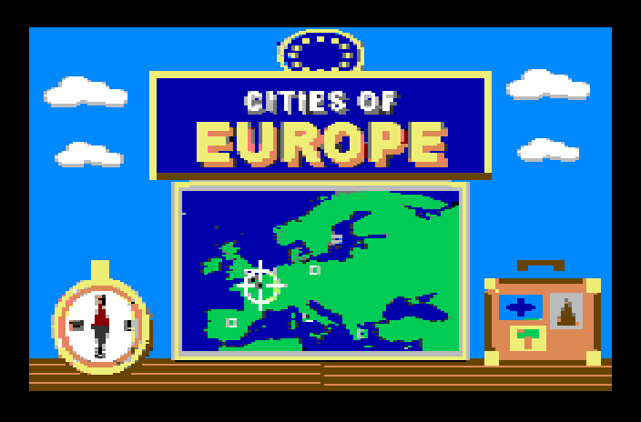
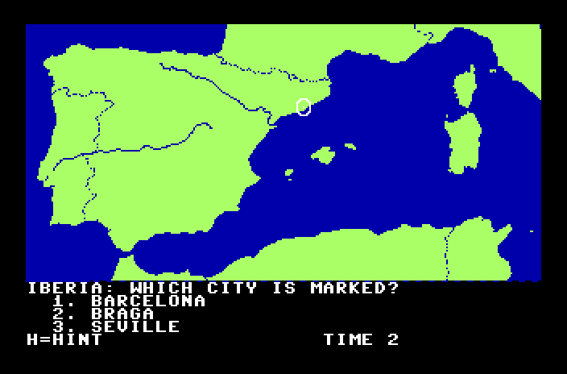
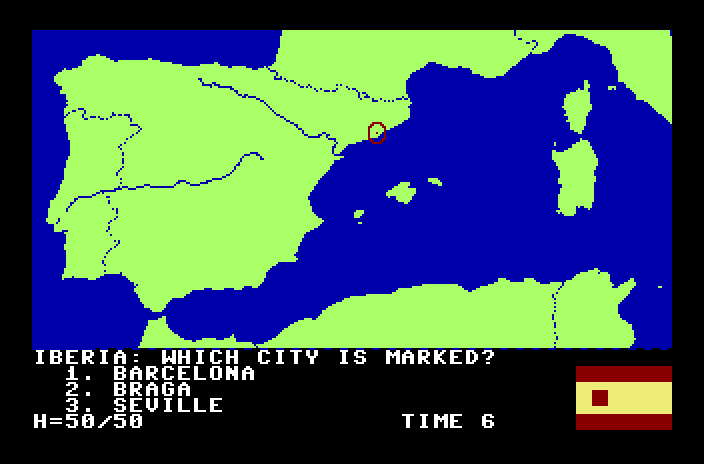
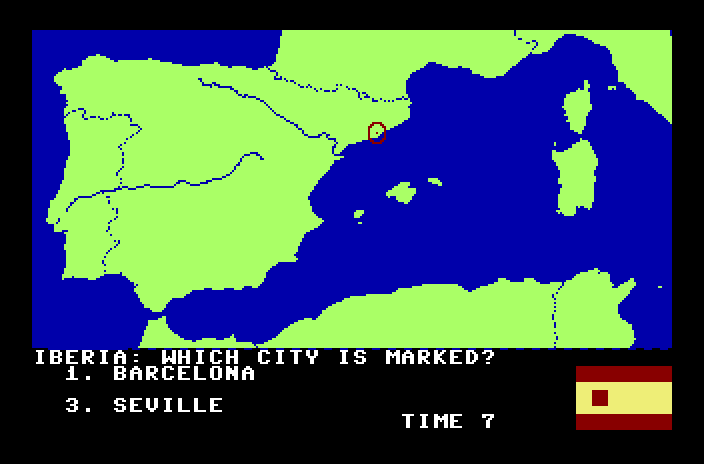
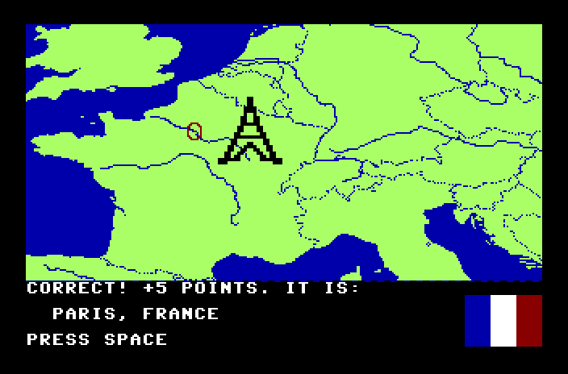
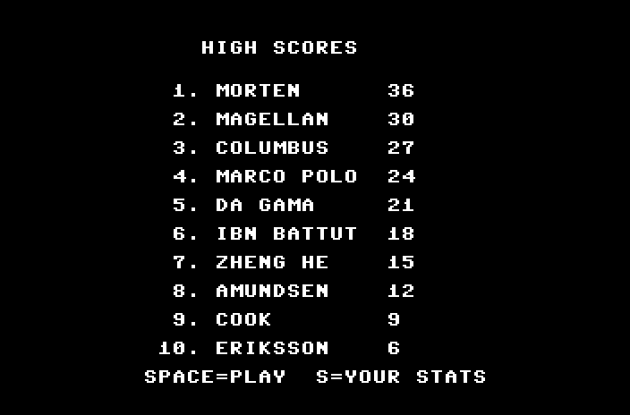
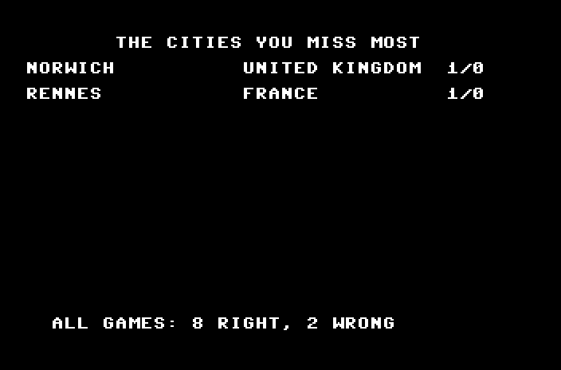

# Cities of Europe

A "name the city" game for the Commodore 64, written in 6502 assembly with
KickAssembler, plus a companion data-file editor. It is the European edition
of [WorldCities](https://github.com/MortenLundberg1977/WorldCities): the same
game, zoomed in on Europe, with 200 cities instead of the world's capitals and
the country's flag as a hint.

## Screenshots

Taken in the VICE emulator.

| | |
|---|---|
|  |  |
| The title screen | A question: which city is marked? |
|  |  |
| Hint 1: the country's flag | Hint 2: 50/50 |
|  |  |
| A quick right answer with no hint: 5 points, and a landmark | The high-score table, saved on the disk |
|  | |
| Your stats: the cities you miss most | |

## Gameplay

The title picture comes up first while the rest of the disk loads (about two
minutes on a real 1541; use warp in VICE to skip the wait). Then the title
music plays (Ode to Joy) and the title and the high-score table take turns.
Press **Space** to play, or **S** to see your stats.

Ten cities are marked one by one with a flashing ring on a hi-res map of
their part of Europe (British Isles, Iberia, France & Benelux, Central Europe,
Italy & Balkans, Nordic & Baltic, Eastern Europe), with country borders
(dotted) and the main rivers. Pick the right city from three choices with keys
**1-3**; the two wrong choices come from the same part of Europe.

- **H** gives a hint: first the flag of the city's country, then a 50/50 that
  removes a wrong choice.
- **Points** for a right answer: 3 without a hint, 2 with the flag, 1 after
  the 50/50; plus 2 if you answer within 5 seconds, 1 within 10. The seconds
  count at the bottom of the screen. At most 50 points a game.
- A right answer plays a rising chime, a wrong one a low buzz. For some cities
  a picture of a landmark appears on the map (the Eiffel Tower, Big Ben, the
  Colosseum, ...; `data/landmarks.txt`).
- **Practice**: the game counts right and wrong answers for every city and
  saves them to the disk after each game. Cities you often get wrong come up
  more often. **S** on the title screen lists the cities you miss most.
- **High scores**: a new top-10 score asks for your name (up to 10 letters,
  Return to finish) and the table is saved to the disk.

Counts and high scores are kept when you rebuild the disk.

The city list (`data/cities.csv`) has 200 cities in 47 countries: the
capitals and the best-known big cities. The game holds up to 220.

## Landmarks

`data/landmarks.txt` has a picture for some cities: the city name (as in the
`CITY` column of `cities.csv`), a colour letter (as in `flags.txt`) and 21
rows of 24 characters, `#` for the picture and `.` for see-through. It is
shown as a double-size hi-res sprite next to the marker when the answer is
revealed. Up to 12 pictures.

## Flags

`data/flags.txt` has one flag per country: a name line (as in the `COUNTRY`
column of `cities.csv`) and 16 rows of 12 colour letters. The game shows it as
a double-size multicolour sprite, so each letter is a 4x2-pixel block. A flag
can use at most 3 colours besides `K` (black, see-through); the letters are
listed at the top of the file. Edit a flag there and rebuild; the build stops
if a country has no flag or a flag has too many colours.

## Title screen

`assets/title.png` is drawn by `tools/draw_title.ps1` (sky, banner, a map of
Europe, compass and suitcase, in C64 colours); the build converts it to a
multicolour bitmap. Replace the PNG with any picture to change it.

## Build and run

Install Java and VICE, including `c1541.exe` and `x64sc.exe`, then run
`build.bat` from this directory. The script looks for `KickAss.jar` here or in
the parent directory. To use a different installation, set `KICKASS_JAR`.
`c1541.exe` must be on `PATH`, or set `C1541_EXE` to its full path.

```bat
build.bat
build.bat run
build.bat run editor
build.bat pull run
```

`pull` gets the latest version from GitHub before building (it needs Git for
Windows). Give a branch name to switch to that branch first
(`build.bat pull my-branch run`). If you have local changes that are not
committed, the pull stops so nothing is overwritten. `run` starts the game in
VICE; `run editor` starts CITYEDIT instead. Close VICE before building: the
build can't replace a disk that VICE has open.

The script assembles both programs, makes the data files with
`prepare_data.ps1`, and writes a fresh `build\citiesofeurope.d64` with
`CITIESOFEUROPE`, `HIGHCODE`, `TITLE`, `HISCORES`, `MAPS`, `LANDMARKS`,
`CITIES`, `FLAGS` and `CITYEDIT`. The cities come from `data/cities.csv`, with
the answer counts and the high scores copied from the old disk (counts matched
by city and country). Other changes saved with CITYEDIT are lost on the next
build: to keep a city, add it to `data/cities.csv`.

There is no fast loader: those upload their own code to the disk drive, which
SD2IEC card readers don't run. Instead the files are packed, and the title
picture loads first.

On Linux or macOS use `tools/build.sh` (needs Python 3 with Pillow). The
GitHub Actions workflow runs it on every push: open the latest **Build** run
on the **Actions** tab and download the **citiesofeurope-d64** artifact.

On a C64 or in VICE without autostart:

```
LOAD"CITIESOFEUROPE",8,1
RUN
```

## The region maps

Each region in `data/regions.csv` has a top-left corner (`LON0`, `LAT0`, in
degrees) and a scale (`DX`, `DY`: hundredths of a degree per pixel). Its map is
320x160 pixels, so it covers `3.2 × DX` degrees of longitude and `1.6 × DY`
degrees of latitude. Each city has a region number in the `REGION` column of
`data/cities.csv`. The build stops if a city lies outside its region's map,
or if a region has fewer than 3 cities.

### How the game turns latitude and longitude into a spot on the map

The maps use an equirectangular projection: degrees of longitude map straight
to pixels across, degrees of latitude straight to pixels down. The C64 works
it out for every question, with whole numbers only (the 6502 has no
fractions and no divide instruction). `calc_pixel` in `src/game.asm` does it:

1. **Read the coordinates.** Each city record holds them as text, e.g.
   `+48.86` and `  +2.35`. `parse_num` reads the sign, the degrees and two
   decimals, and makes a signed 16-bit number in hundredths of a degree:
   `+48.86` → 4886, `-9.14` → −914.
2. **Look up the region.** The `MAPS` file starts with a table of the regions:
   corner (`LON0`, `LAT0`, also in hundredths) and scale (`DX`, `DY`). They are
   the numbers from `data/regions.csv`.
3. **Measure from the corner.** Subtract: `lon − LON0` is how far east of the
   map's left edge the city is, `LAT0 − lat` how far south of its top edge.
   If the longitude difference comes out negative, 360° (36000) is added, so
   a map may cross the 180° line.
4. **Divide by the scale.** `x = (lon − LON0) / DX` and
   `y = (LAT0 − lat) / DY`, with a 16-bit shift-and-subtract division
   (`div16`). The result is the pixel: x 0-319, y 0-159.
5. **Place the marker.** The marker is a sprite. The visible screen starts at
   sprite position (24, 50) and the ring's centre is 5 pixels in, so the
   sprite goes to (x + 19, y + 45); x above 255 sets the sprite's 9th x bit.

Example, Paris (48.86 N, 2.35 E) on the France & Benelux map (`LON0` −5,
`LAT0` 53.5, `DX` 7, `DY` 7):

```
x = (235 − (−500)) / 7 = 735 / 7 = 105
y = (5350 − 4886) / 7  = 464 / 7 = 66      → sprite at (124, 111)
```

The maps themselves are drawn by `tools/render_map.ps1` with the very same
formula and the same numbers, so a city's marker always lands where the city
is on the map. Nothing has to be lined up by hand: change a region in
`regions.csv`, redraw the maps, and the marker follows.

The pixels aren't square in degrees: `DY` is a little larger than
`DX × cos(latitude)` would make it, which stretches the maps vertically so
the regions fill the 2:1 map area. The stretch is the same for the map and
the marker, so it doesn't move the marker off its city.

To change a region, edit `data/regions.csv` and redraw the maps:

```bat
powershell -File tools\render_map.ps1 ne_50m_land.geojson -Borders ne_50m_admin_0_boundary_lines_land.geojson -Rivers ne_50m_rivers_lake_centerlines.geojson -RiverRank 5
```

The GeoJSON files are Natural Earth's public-domain 1:50m data (the
`geojson` folder of https://github.com/nvkelso/natural-earth-vector): land
outlines, country borders (drawn dotted) and rivers (solid; `-RiverRank`
leaves out the smaller ones). Borders and rivers are drawn in sea colour,
because the hi-res map has only two colours per 8x8 block. It takes a few
minutes; commit the new `assets/maps/region*.png`.

## CITYEDIT

Edits the CITIES file on the disk. Keys: cursor up/down to select, **A** add,
**E** edit, **D** delete, **S** save, **R** reload, **Q** back to the title.
While editing, type over the field, Delete to go back, Return for the next
field (city, country, latitude, longitude, region). Coordinates are degrees
with two decimals and a sign, e.g. `+55.68` and `-171.77`. CITYEDIT doesn't
check that a city fits its region's map; the build does.

## Project files

- `src/game.asm` — the game: loading, region maps (unpacked into a bitmap with
  a raster split to text for the bottom five rows), marker, flag and landmark
  sprites, questions, hints, points, timer, answer counts, sounds; and in a
  second part (`HIGHCODE`, at `$C800`) the title loop, high scores, stats and
  the music player. It is the same file in World Cities and Cities of Europe.
- `src/config.asm` — what differs between the two: the hint (flag or country
  name), the text title and the title tune
- `src/citiesofeurope.asm` — imports the two
- `src/cityedit.asm` — the CITIES editor
- `data/cities.csv` — the cities: city, country, latitude, longitude, region
  (names up to 16 characters)
- `data/regions.csv` — the regions: name, corner and scale of each map
- `data/flags.txt` — the flags, as letter grids
- `data/landmarks.txt` — the landmark pictures
- `assets/maps/region*.png` — the region maps (320x160, black land, white sea)
- `assets/title.png` (optional) — the title picture, any size; the build
  scales it to fit the screen and converts it to a multicolour bitmap. Without
  it the game shows a text title.
- `prepare_data.ps1` — makes `CITIES` (59-byte records loading to `$3900`),
  `MAPS` (region table and packed maps loading to `$6C40`), `LANDMARKS`,
  `HISCORES`, `FLAGS` and `TITLE`; the layouts are described at the top of
  each part
- `build.bat` — KickAssembler build, D64 packaging, and optional VICE launch
- `tools/build.sh`, `tools/prepare_data.py` — the same build for Linux/macOS
- `tools/render_map.ps1` — draws `assets/maps/` from Natural Earth data
- `tools/draw_title.ps1` — draws `assets/title.png`
